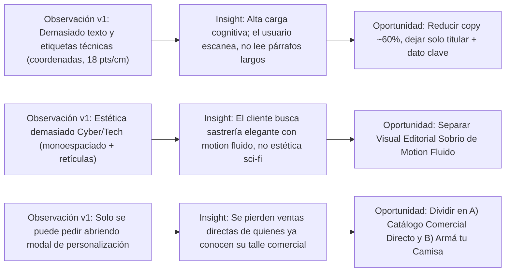

# 01. UX Research & Discovery Synthesis — Cristian Mancuso

> **Rol:** UX Researcher & Product Owner  
> **Metodología:** Análisis heurístico de sitio actual (`cristianmancuso.ar`), definición de *Jobs-to-be-Done (JTBD)* y validación iterativa sobre el Prototipo v1 (`cristianmancuso.pages.dev`).

---

## 1. Resumen Ejecutivo
Cristian Mancuso cuenta con un diferencial competitivo extraordinario —**confección a medida sin costo adicional incluso en telas base**—, pero la tienda actual en Tiendanube lo oculta bajo una estética genérica y navegación estándar. En la **Iteración 1** del rediseño validamos la potencia del *motion* y del esquema de medidas, pero detectamos **3 fricciones críticas**: exceso de texto, sobrecarga visual "tech/futurista" que desplazaba la calidez sastrera, y ausencia de compra rápida por talle comercial.

---

## 2. Jobs-to-be-Done (JTBD) por Segmento

| Perfil | Contexto | Job-to-be-Done (JTBD) | Fricción Principal |
| :--- | :--- | :--- | :--- |
| **Comprador Rápido (BA / Interior)** | Hombre 30–45 años que busca resolver una compra puntual | *"Cuando necesito una camisa de calidad rápido, quiero elegir tela y talle comercial y sumarla al carrito en 2 clics para no perder tiempo."* | Obligarlo a pasar por un modal de personalización frena la compra impulsiva. |
| **Cliente A Medida (BA / Interior / Exterior)** | Busca calce perfecto (MX, US, ES, ARG) | *"Cuando quiero una camisa única, quiero elegir tela, cuello, botón y cargar mis medidas viendo el resultado en vivo para sentir seguridad antes de pedir."* | Miedo a equivocarse al tomar las medidas a distancia. |
| **Dueño / Sastre (Cristian)** | Operación y stock diario | *"Cuando entra un pedido o consulta, necesito el código interno exacto (`Ref. Art. 2529`) para saber qué rollo de tela cortar y verificar stock."* | Perder el código interno rompe la operación cuando hay 10 variantes de celeste. |

---

## 3. Síntesis de Validación: Iteración 1 → Oportunidades (Iteración 2)

---

## 4. Matriz de Severidad (Hallazgos v1)

| Hallazgo | Frecuencia | Severidad | Decisión para v2 |
| :--- | :--- | :--- | :--- |
| Sin botón directo "Agregar al carrito" por talle comercial | Alta | **Crítica** | Incorporar selector de talle (`38–46` / `S–XL`) + CTA directo en cada card de la Sección A. |
| Exceso de texto y badges técnicos | Alta | **Alta** | Recortar microcopy; mantener `Ref. Art.` en jerarquía discreta. |
| Configurador escondido en modal | Media | **Alta** | Transformarlo en la Sección B protagonista: **"Armá tu camisa"** con tiras horizontales y cotas en vivo. |
| Estética visual percibida como "muy futurista" | Media | **Media** | Mantener el *motion* fluido (GSAP/Lenis), pero limpiar el UI hacia editorial sobrio. |
