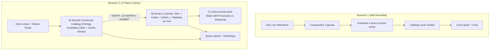
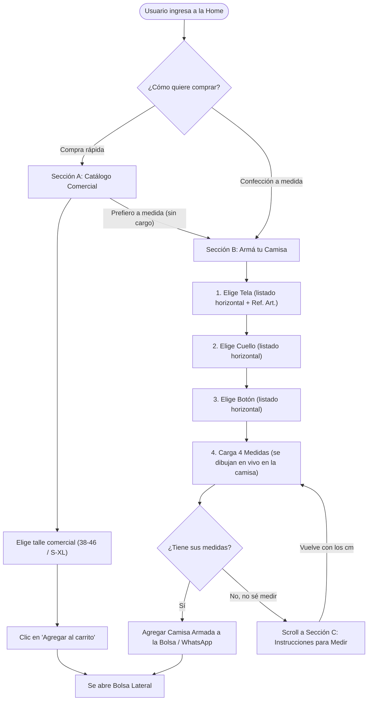

# 02. UX Flow & Information Architecture — Cristian Mancuso (v2)

> **Rol:** UX Designer — Flow Architect  
> **Objetivo:** Reestructurar la experiencia en **3 pilares claros** sin fricción cognitiva, separando la compra rápida de la confección a medida.

---

## 1. Arquitectura de Información (Antes vs. Después)

---

## 2. User Flow Principal: Compra Comercial vs. A Medida

---

## 3. Matriz de Estados (Zero Orphan States)

| Componente / Flujo | `Empty` | `Partial / Editing` | `Error / Validation` | `Success` |
| :--- | :--- | :--- | :--- | :--- |
| **Sección A (Catálogo)** | Filtro sin resultados: *"No hay telas en esta gama. Ver todas."* | Talle preseleccionado por defecto para 1-clic. | Botón deshabilitado si no hay talle elegido (con tooltip claro). | Feedback visual `"✓ Agregada"` + apertura sutil de bolsa. |
| **Sección B (Armá tu camisa)** | Camisa base con cotas `-- cm` esperando medidas. | Al tipear cada medida (`39`, `54`, `64`, `74`), aparece el N° en vivo sobre el esquema. | Si ingresa valor fuera de rango lógico (ej. cuello `120`), aviso inline amable. | Resumen completo listo para sumar a la bolsa o enviar a WhatsApp con `Ref. Art.`. |
| **Bolsa Lateral** | *"Tu bolsa está vacía"* + CTA `"Ir al catálogo"`. | Muestra tanto camisas comerciales como configuradas a medida. | Sin conexión: permite copiar el texto del pedido al portapapeles como *fallback*. | Redirección limpia a WhatsApp con el pedido completo. |
