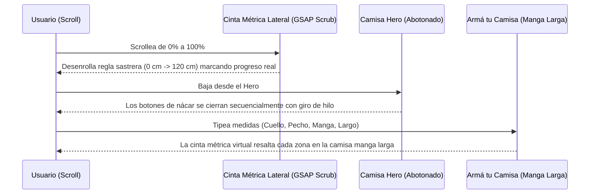

# 05. Product Designer Handoff Spec & Motion Choreography (v3)

> **Roles:** Product Designer, UI System Critic, UX Flow Architect & Motion Designer  
> **Objetivo:** Elevar la V2 corrigiendo 4 puntos detectados en revisión visual en vivo: paleta apagada, exceso de telas/cards grandes, SVG en manga corta y pérdida de "acción narrativa" al scrollear.

---

## 1. Pivote de Paleta de Color (Midnight Navy & Lino Puro)

Reemplazamos el negro plano + beige apagado por una paleta inspirada en sastrería masculina de lujo (*Midnight Navy + Blanco Lino + Bronce Hilo*):

| Token | Valor Anterior (v2) | Valor Nuevo (v3) | Uso |
| :--- | :--- | :--- | :--- |
| `--bg-light` | `#F4F1EA` (beige apagado) | `#FAF8F5` (Blanco Lino luminoso) | Fondo principal de Catálogo y Guía de Medidas |
| `--bg-navy` | `#0B0B0D` (negro plano) | `#0F172A` (Midnight Navy sastrero) | Hero, Configurador "Armá tu camisa" y Footer |
| `--surface-card-light` | `#FFFFFF` | `#FFFFFF` con borde `#E6E2DA` | Tarjetas sobre fondo claro |
| `--surface-card-dark` | `#101218` | `#162033` con borde `rgba(255,255,255,0.10)` | Tarjetas sobre Midnight Navy |
| `--accent-bronze` | `#C2A36B` | `#C59B5F` (Hilo Bronce) | Costuras, cotas activas, badges y detalles |
| `--text-dark` | `#121215` | `#0F172A` | Titulares y cuerpo sobre fondo claro |
| `--text-light` | `#F5F2EB` | `#F8FAFC` | Titulares y cuerpo sobre Midnight Navy |

---

## 2. Coreografía de Scroll ("Acción Sastrera en Vivo")

---

## 3. Especificación de Componentes Modificados (Handoff)

### A. `ShirtArtwork.tsx` — Camisa Manga Larga Obligatoria
- **Anatomía:** Mangas largas completas con caída natural hasta los **puños abotonados** (doble o simple), tapeta de manga y espacio visible en el **puño izquierdo** para las iniciales bordadas.
- **Estado animado en Hero:** 4 botones de nácar que pasan de "abierto" (desplazado/suelto) a "abotonado" (centrado con hilo en cruz `#C59B5F`) sincronizados con `ScrollTrigger` (`scrub: 0.6`).

### B. `TailorTapeProgress.tsx` — Cinta Métrica de Sastre al Scrollear
- **Ubicación:** Lateral derecho fijo (`hidden xl:flex`) o barra superior sutil en mobile.
- **Comportamiento:** Regla graduada minimalista (`0 cm` a `100 cm`) en `#C59B5F` cuya aguja/indicador avanza con `scrollYProgress` mostrando los centímetros recorridos y el nombre de la sección actual (`00 Inicio` · `35 Colección` · `70 A Medida` · `100 Medidas`).

### C. `CatalogSection.tsx` & `ShirtBuilderSection.tsx` — Curaduría y Swatches Cuadrados
- **Catálogo Comercial (Bloque A):** Mostrar **4 telas curadas principales** por defecto (con botón discreto `"Ver las 7 telas"` para expandir si el usuario quiere) para evitar saturación visual.
- **Swatches en Bloque B ("1. Tipo de tela"):** Cards **cuadradas y compactas** (`w-24` / `96x96px` el paño de tela + nombre corto + `Ref. Art.` debajo), sin scrollbar horizontal nativo visible (usar flechas laterales limpias o scroll oculto `scrollbar-none`).
- **Accessibility & Edge Cases:**
  - `min-h-[44px]` en todos los botones y chips táctiles.
  - Si `isMotionPaused` es `true`, la cinta métrica muestra estado estático y los botones aparecen ya abotonados.
