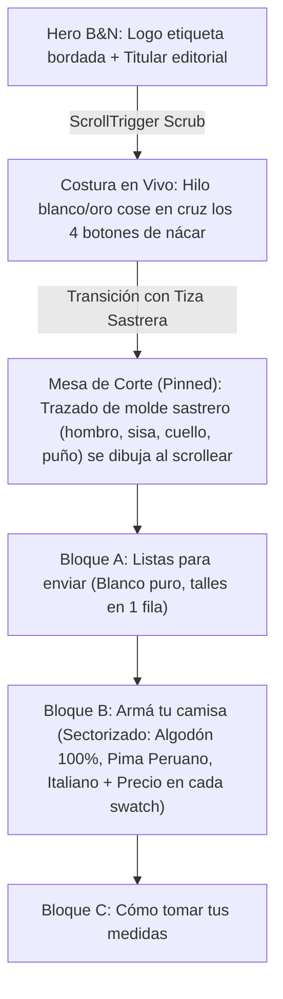

# 06. V4 Discovery, Critique & Handoff Spec — Monocromo Editorial B&N + Efecto WOW Sastrero

> **Roles:** Product Owner, UX Researcher, UX Flow Architect, UI System Critic & Product Designer  
> **Evidencia:** Revisión visual de capturas V3 (`cristianmancuso.pages.dev`).

---

## 1. Hallazgos de Validación V3 (Qué falló y cómo se resuelve en V4)

| Área | Diagnóstico V3 | Decisión V4 (Solución) |
| :--- | :--- | :--- |
| **Paleta de Color** | Azul marino + crema se percibe apagado y desconectado del logo real (blanco sobre negro). | **Monocromo Editorial Puro:** Negro Profundo `#09090B` + Blanco Puro `#FFFFFF` + Gris Perla `#F4F4F5`, con un único acento sutil en **Champagne Platino / Oro Pálido `#C9A96E`** solo para puntadas e iniciales bordadas. |
| **Header** | Barra genérica sin identidad textil. | **Header Etiqueta Sastrera:** Fondo negro `#09090B` con **pespunte fino (dashed stitch border)** y el logo `CM // CRISTIAN MANCUSO` diseñado como una **etiqueta tejida bordada de cuello**. |
| **Talles Comerciales** | `38 40 42 44` en una fila y `46` caído a un segundo renglón. | **Grilla fija de 1 renglón (`grid-cols-5` o `flex-nowrap` compacto)** para que todos los talles convivan en una sola línea limpia. |
| **Telas en "Armá tu camisa"** | Tira única mezclada sin precios visibles. | **Sectorización por 3 categorías** (`Algodón 100%`, `Algodón Pima Peruano`, `Algodón Italiano`) con **swatches cuadrados que muestran precio + `Ref. Art.`** debajo de cada paño. |
| **Efecto WOW al Scrollear** | Cinta lateral derecha demasiado pequeña; los botones del Hero apenas se desplazaban. | **Escena "El Oficio del Sastre" (GSAP ScrollTrigger):** Trazado de **tiza sastrera** dibujando el molde de la camisa en tiempo real + **aguja e hilo cosiendo puntadas en cruz (`X`)** sobre los botones y conectando secciones al scrollear. |

---

## 2. Arquitectura del "Efecto WOW" (Scroll Choreography)

---

## 3. Handoff Spec para Desarrollo (V4)

1. **Paleta estricta:**
   - `--bg-black`: `#09090B` (Hero, Mesa de Corte, Armá tu Camisa, Footer)
   - `--bg-white`: `#FFFFFF` y `--bg-pearl`: `#F4F4F5` (Bloque A Comercial, Bloque C Medidas)
   - `--border-subtle`: `#E4E4E7` (claro) / `rgba(255,255,255,0.12)` (oscuro)
   - `--stitch-accent`: `#C9A96E` (hilo sastrero sutil)
2. **Navbar Etiqueta Bordada:**
   - Monograma con **borde pespunteado (`1px dashed`)** y 4 puntos de costura en las esquinas simulando la etiqueta cosida en el cuello de la camisa.
   - Eliminar el botón "Pausar movimiento" del centro protagonista (moverlo discreto al footer para limpiar el header y dejar solo: Logo · Links · Bolsa).
3. **Catálogo Comercial (1 renglón de talles):**
   - `grid-cols-5 gap-1.5` para talles `38`, `40`, `42`, `44`, `46` (y `grid-cols-4` para `S`, `M`, `L`, `XL`) garantizando **1 sola fila** en desktop y mobile.
4. **Swatches Sectorizados en "Armá tu camisa":**
   - Mini-tabs arriba del paso 1: `Algodón 100%` | `Algodón Pima Peruano` | `Algodón Italiano` (+ `Donna`).
   - Cada swatch cuadrado muestra: Paño de tela + Nombre corto + `Ref. Art.` + **Precio en ARS/USD**.
