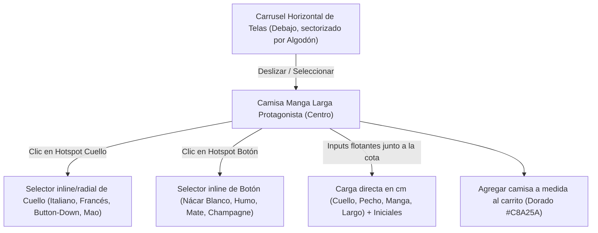

# 07. V6 UI System Critique & Centered Builder Spec — Cristian Mancuso

> **Roles:** UI Designer (System Critic), UX Designer (Flow Architect) & Product Designer  
> **Evidencia:** Auditoría visual sobre capturas de V5 (`cristianmancuso.pages.dev`).

---

## 1. Hallazgos Críticos de UI/UX en V5

| Problema Detectado (Evidencia V5) | Impacto en Usuario | Solución Definitiva V6 |
| :--- | :--- | :--- |
| **Alternancia constante Oscuro ↔ Claro** | Fatiga visual al scrollear entre Hero oscuro, Catálogo blanco, Armá oscuro y Medidas blancas. | **Universo Oscuro Unificado (`#111113` / `#161619`):** Toda la web mantiene una atmósfera sastrera continua sin saltos de brillo bruscos. |
| **Fondos desparejos en tarjetas de camisas** | En "Listas para enviar", las camisas oscuras tenían fondo negro y las claras fondo gris claro. | **Uniformidad total:** Todas las tarjetas de producto comparten exactamente el mismo fondo de estudio (`#1B1B1F`). |
| **Header con pespunte incompleto** | La costura `dashed` solo aparecía arriba y abajo, cortándose en los bordes laterales. | **Pespunte perimetral completo:** Borde interior redondeado (`inset-1.5 rounded-xl border-dashed`) que rodea los 4 lados de la cápsula como un puño real. |
| **Cinta métrica lateral oscura** | Al ser color carbón, no parecía una cinta métrica real de sastre. | **Cinta métrica natural:** Color marfil/crema sastrero (`#EFE8D8`) con graduación y números en negro (`#111113`), manteniendo el cursor en `#C8A25A`. |
| **Asimetría en "Armá tu camisa"** | La columna izquierda era mucho más alta que la tarjeta sticky derecha, dejando espacio muerto y obligando a scrollear para ver los inputs. | **Escenario Centrado Interactivo:** Camisa manga larga centrada con **controles directos sobre la prenda** (hotspots en Cuello y Botones, inputs `cm` integrados junto a cada cota) y **carrusel horizontal de telas** debajo. |

---

## 2. Nuevo Flujo Centrado de "Armá tu camisa" (V6)

