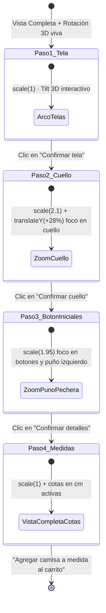

# 10. V9 Dynamic Camera & Progressive Stepper Spec — "Armá tu camisa"

> **Roles:** UX Designer (Flow Architect), Product Designer & Motion Designer  
> **Concepto:** Transformar el configurador en un **escenario cinematográfico con cámara dinámica** (inspirado en configuradores de lujo tipo Apple/Porsche), mostrando **un único paso por vez** con zoom automático a la zona que el cliente está personalizando.

---

## 1. Flujo de Cámara & Pasos (State Diagram)

---

## 2. Reglas de UX & Motion (Handoff para Desarrollo)

1. **¿Por qué botón "Confirmar" en lugar de salto inmediato al primer clic?**
   - En el **Paso 1 (Tela)**, el cliente quiere comparar 2 o 3 telas en el Arco `︶` antes de pasar al cuello. Si avanzara al primer toque, no podría probar telas cómodamente.
   - Solución: Al tocar una tela en el Arco `︶`, la camisa cambia en vivo y el botón principal muestra **"Confirmar tela → Cuello"** (avance intencional, cero saltos accidentales).
   - Además, los **4 tabs superiores del Dock** (`1. Tela`, `2. Cuello`, `3. Botón & Iniciales`, `4. Medidas`) siempre permiten navegar libremente hacia atrás o adelante.

2. **Comportamiento de la Cámara en el Escenario (`overflow-hidden` en el viewport de la prenda):**
   - **Paso 1 (Tela):** `scale: 1, x: 0, y: 0` + **rotación/tilt 3D suave** al mover el mouse (o vaivén sutil continuo si no hay hover, respetando `isMotionPaused`).
   - **Paso 2 (Cuello):** Cámara hace zoom suave (`scale: 2.1, y: "26%"`) enfocando el cuello en primer plano macro.
   - **Paso 3 (Botón & Iniciales):** Cámara hace paneo/zoom suave (`scale: 1.9, x: "-6%", y: "-14%"` o centrado en pechera/puño según ubicación de iniciales) para ver el detalle de los botones y el bordado `C.M.`.
   - **Paso 4 (Medidas):** Zoom out suave (`scale: 1, x: 0, y: 0`) mostrando la camisa completa con sus 4 cotas en `cm`.

3. **Reducción de Densidad en Pantalla:**
   - En todo momento hay **un solo dock `.liquid-glass` debajo de la camisa** con los controles exclusivos del paso activo. Cero cajas laterales.
