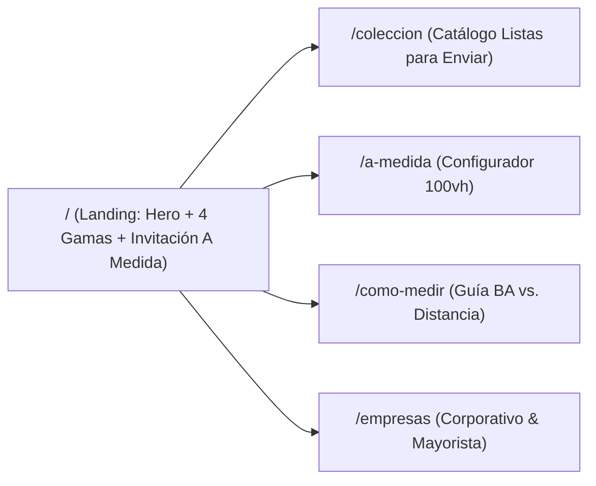

# 13. V12 Architecture Spec — Multi-Página, Modo Claro Editorial & Opciones Reales

> **Roles:** UX Designer (Flow Architect), Product Owner, UI System Critic & Product Designer  
> **Objetivo:** Eliminar la saturación de la Home dividiendo el sitio en rutas especializadas, incorporar **Modo Claro Editorial (con toggle Claro/Oscuro)** y usar las **opciones reales de Cristian Mancuso** con fotos macro reales para Cuellos y Botones.

---

## 1. Arquitectura Multi-Página (Static Export Compatible)

- **Landing (`/`):** Máximo 3 bloques limpios y respirables. Sin scroll interminable ni formularios pesados.
- **Catálogo (`/coleccion`):** Filtros por gama, toggle `ARS/USD`, talles en 1 fila, botón `"Agregar al carrito"` y acceso directo a `/a-medida?tela=...`.
- **Configurador (`/a-medida`):** Experiencia enfocada en 1 pantalla (`100svh`) sin distracciones externas.
- **Guía (`/como-medir`):** Modalidad presencial Buenos Aires vs. a distancia (Argentina, MX, US, ES) + esquema interactivo de 4 medidas.

---

## 2. Opciones Reales de Sastrería (Configurador `/a-medida`)

- **5 Tipos de Cuello (con foto macro real para Paso 2):**
  1. `Italiano`
  2. `Francés`
  3. `Oxford`
  4. `Americano`
  5. `Mao`
- **4 Tipos de Botón (con foto macro real para Paso 3):**
  1. `Blanco`
  2. `Negro`
  3. `Mismo tono que la camisa`
  4. `Nácar blanco`
- **Iniciales Bordadas:** Selector de color de hilo (`Blanco`, `Negro`, `Champagne`, `Azul Noche`) + inclinación en perspectiva y textura de puntada sobre el macro de puño/pechera.

---

## 3. Sistema Dual Claro / Oscuro (Liquid Glass Editorial)
- **Modo Claro (por defecto):** Fondo **Blanco Alabastro `#F7F6F3`**, paneles Liquid Glass claros (`bg-white/75 backdrop-blur-2xl border-black/10`), texto **Negro Tinta `#111113`** y acento **Azul Marino Sastrero `#16233B`**.
- **Modo Oscuro (toggle en Navbar):** Fondo `#0B0B0E` con Liquid Glass oscuro.
- **Logo adaptativo (`BrandLogo.tsx`):** Invierte automáticamente entre negro sobre claro y blanco sobre oscuro.
