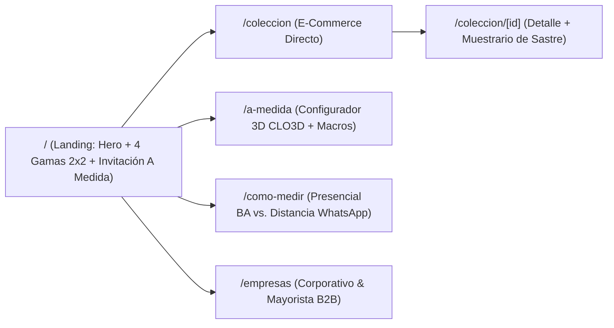

# 19. Case Study Final — Rediseño Digital Cristian Mancuso

> **Roles Cubiertos:** Product Owner, UX Researcher, UX Flow Architect, UI System Critic, UX Writer & Motion Designer  
> **Stack Final:** Next.js 16 (Static Export para Cloudflare Pages) · TypeScript · Tailwind CSS v4 · Three.js / R3F (`.glb` CLO3D) · GSAP + Lenis · Framer Motion  
> **URL Prototipo:** `https://cristianmancuso.pages.dev/`

---

## 1. El Problema & Oportunidad de Negocio
Cristian Mancuso es una casa argentina de alta camisería con un diferencial competitivo único: **confección a medida sin costo adicional en todas sus gamas** (desde *Algodón Urbano* hasta *Pima Peruano* y *Lino Italiano*).  
Sin embargo, su tienda previa en Tiendanube diluía ese diferencial bajo una estética genérica y no separaba la compra rápida por talle comercial de la experiencia personalizada a medida.

---

## 2. Arquitectura Final (De Home Monolítica a 5 Rutas Especializadas)

---

## 3. Pivotes Clave Basados en Validación Visual (V1 → V21.1)

| Iteración | Hallazgo / Fricción Detectada | Decisión de Diseño y Resultado |
| :--- | :--- | :--- |
| **V1 → V2** | Exceso de texto técnico y estética demasiado sci-fi; ausencia de compra rápida por talle. | Recorte de copy >50% (`UX Writer`) y separación entre compra comercial y armado a medida. |
| **V7 → V12** | Home saturada intentando hacer 5 trabajos a la vez; modo oscuro continuo fatigaba. | **Arquitectura multi-ruta** (`/`, `/coleccion`, `/a-medida`, `/como-medir`, `/empresas`) + **Modo Claro Editorial `#F7F6F3`** por defecto con toggle a Oscuro. |
| **V10 → V17.3** | SVGs 2D y primitivas 3D parecían artificiales. | Integración de **modelo 3D real exportado de CLO3D (`shirt.glb`)** con proyección procedural de telas (incluyendo cuadros continuos 3D) + **fotos macro reales** para los 5 cuellos y 4 botones + iniciales bordadas en perspectiva. |
| **V18 → V18.7** | Carga lenta en 4G mobile (`22.5 MB`) y colapso de `<Canvas>` en Safari iOS. | Compresión de `shirt.glb` a **`1.2 MB`** y PNGs a `~80 KB`, desactivación de Lenis en touch (`60 FPS`), alturas explícitas para iOS Safari y loader de silueta sastrera con shimmer. |
| **V20 → V21.1** | Inconsistencias tipográficas (`Syne` vs `Plus Jakarta`), tokens heredados en `/empresas` y anchos desalineados. | **Design System v2.0** unificado en `Plus Jakarta Sans`, riel óptico único **`max-w-[1360px]`** (estándar validado para `1280px`–`1920px+`), cápsulas `rounded-full` y CTAs `#16233B`. |

---

## 4. Validación Heurística & Estándares Cumplidos
- **Alineación Óptica & Grilla (Gestalt + 8pt Grid):** Riel único `max-w-[1360px]` desde Header hasta Footer; funciona de forma consistente desde netbooks (`1280px`) hasta monitores widescreen (`1920px+`).
- **Ley de Fitts & Accesibilidad:** Botones primarios y selectores `min-h-[44px]`, soporte `prefers-reduced-motion`, botón de pausa de movimiento y contraste WCAG AA en Modo Claro y Oscuro.
- **Operación Real del Negocio:** Jerarquía dual preservando los códigos internos `Ref. Art. XXXX` para Cristian e inyectándolos automáticamente en los pedidos por WhatsApp.

---

## 5. Próximo Paso de Validación Real (Guión de Usability Testing — 5 Usuarios)
Para validar cuantitativamente en producción con 5 clientes del perfil objetivo (hombres 30–45 años de Buenos Aires, interior y exterior):
1. **Tarea 1 (E-Commerce Directo):** *"Necesitás una camisa negra de lino para un evento el fin de semana en talle 42. Agregala a tu bolsa."* → Meta: `< 30 seg`, `0` errores.
2. **Tarea 2 (Confección A Medida):** *"Querés una camisa Pima celeste con cuello Italiano, botón nácar blanco, tus iniciales en el puño y tus medidas cargadas."* → Meta: completar los 4 pasos sin abandonar ni preguntar cómo medir.
3. **Métrica Post-Test (SEQ 1–7):** Evaluar facilidad percibida y confianza para comprar a distancia.
